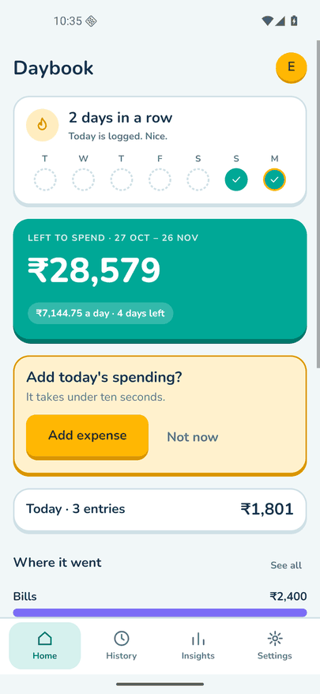
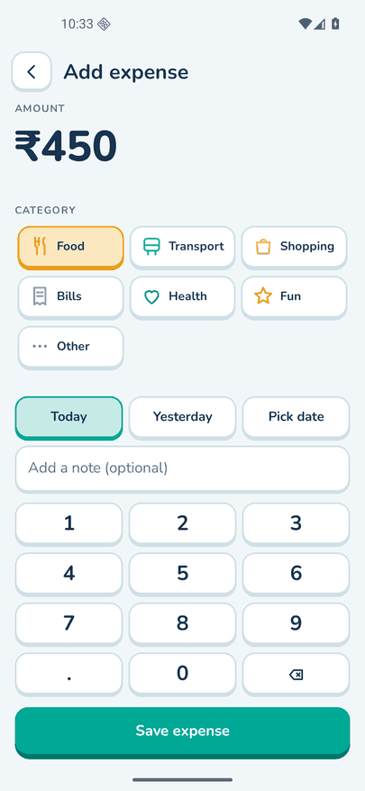
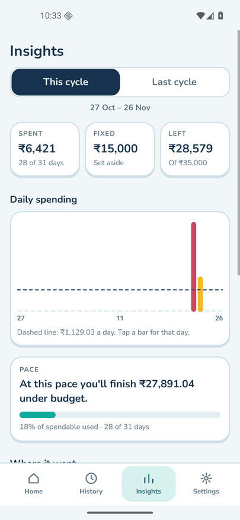
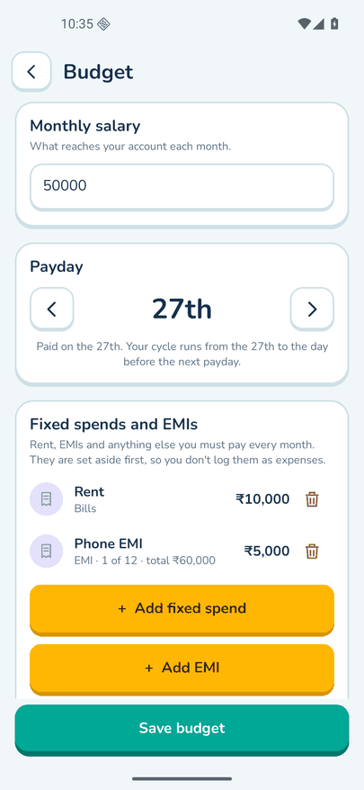
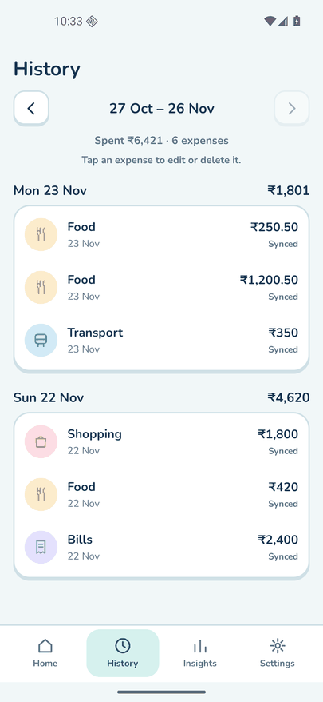
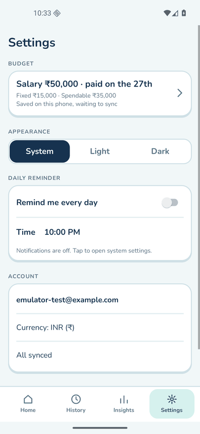
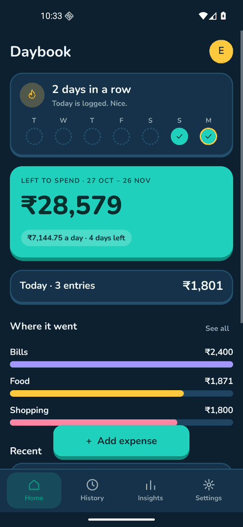
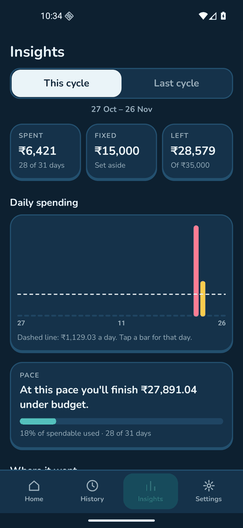

# Daybook

A small personal finance app for Android. Log what you spend in a few taps, even offline, and always see what is left to spend until your next payday.

- **Fast entry:** an on-screen number pad, category and date chips, an optional note saying where the money went, and quick picks that repeat your last expense or one you log often. Works offline and syncs later.
- **Widget and shortcut:** a home-screen widget shows what is left and the daily allowance, with a + button that opens Add expense; long-pressing the app icon offers the same shortcut.
- **Pay-cycle budget:** enter your salary, your payday, and fixed monthly spends such as rent. Home shows what is left and how much you can spend per day.
- **EMIs:** enter an EMI once (instalment, months, total) and it is set aside automatically every cycle until it ends.
- **Savings target and one-off income:** keep an amount aside every cycle, and add a bonus or freelance payment to the cycle it arrives in.
- **Insights:** daily spending against your budget, a pace forecast, category breakdown, and a comparison with the last cycle.
- **Streak, reminder and budget alerts:** a daily streak for logging, an optional daily reminder, and optional alerts when you are ahead of pace, have used most of the budget, or are over it. None of them shows an amount.
- **Light and dark:** follow the phone or pick one in Settings.

Everything is INR. Amounts are stored as integer paise. Built for one person, so there is no email verification and no password reset.

## Screenshots

<table>
  <tr>
    <td align="center"><br><sub>Home</sub></td>
    <td align="center"><br><sub>Add expense</sub></td>
    <td align="center"><br><sub>Insights</sub></td>
    <td align="center"><br><sub>Budget and EMIs</sub></td>
  </tr>
  <tr>
    <td align="center"><br><sub>History</sub></td>
    <td align="center"><br><sub>Settings</sub></td>
    <td align="center"><br><sub>Home, dark</sub></td>
    <td align="center"><br><sub>Insights, dark</sub></td>
  </tr>
</table>

<sub>Captured from the app on an Android 16 (API 36) emulator with sample data.</sub>

## Repository layout

| Path | What it is |
| --- | --- |
| `mobile/` | Native Kotlin Android app (XML Views, one module, no UI library). See [mobile/README.md](mobile/README.md). |
| `server/` | TypeScript API on Bun with Mongoose, deployed on Vercel. See [server/README.md](server/README.md). |
| `docs/design.md` | The UI design: tokens, components, every screen and state. |
| `.agents/` | Project-local guidance for AI coding agents. [AGENTS.md](AGENTS.md) has the working rules. |

## How the money works

**Pay cycle.** A cycle starts on your payday and ends the day before the next one (payday the 27th gives 27 Nov – 26 Dec). If a month is shorter than your payday, the cycle starts on that month's last day. With payday 1, a cycle is a calendar month. History, Insights and the budget all follow the cycle.

**Fixed spends.** Rent and other monthly commitments are *set aside* at the start of each cycle. They are not entered as expenses, so they are never counted twice.

**EMIs.** An EMI is a fixed spend with a number of months (1–120) and a first cycle. It is set aside in each cycle from then until its last instalment, then stops, and what you can spend goes back up. You can enter the total cost or the instalment (the other is calculated), start this cycle or next, or say how many instalments are already paid. An EMI can also be started from Add expense ("Paying in instalments?"), which sets up the EMI instead of saving a one-off expense.

**Savings target.** An amount kept aside every cycle. Like a fixed spend it lowers what you can spend; it is not an expense and is never logged.

**One-off income.** A bonus or freelance payment with a name, an amount and the date it arrived. It raises what you can spend only in the cycle that contains that date; later cycles are unaffected.

**Left to spend** = salary + one-off income in the cycle − fixed spends and EMI instalments in the cycle − savings target − expenses logged in the cycle (pending ones included). **Daily allowance** = left ÷ days remaining including today, rounded down to the paisa. Overspending shows as "Over by ₹…", never as zero. Without a budget, Home shows today's and this month's totals and offers to set one up.

**Insights** (computed on the phone from local data): spent / fixed / left, daily bars against the budget per day, a pace forecast ("at this pace you'll finish ₹X under budget"), category ranking, average per day, biggest spend, no-spend days, and the change versus the previous cycle up to the same day.

**Quick picks.** Add expense offers up to five chips from the last 120 days: *Repeat* (the most recent expense) and then any amount logged at least twice with the same category and note, most frequent first. One tap fills the amount, category and note; nothing is saved until you press Save. They are hidden when editing.

**Streak.** The number of consecutive days with at least one expense, counted back from today (or from yesterday if today has none yet).

## Rules the app follows

- **Offline first.** An expense is written to the phone's database before success is shown, and marked *pending*, *synced* or *failed*. Uploads retry safely with a client-generated ID, so a reconnect cannot create duplicates. Editing or deleting an already-synced expense needs a connection.
- **Dates are local calendar dates.** An expense belongs to the day you pick, never shifted by UTC.
- **Accounts are separate.** Local data and pending uploads are kept per account; every server query is scoped to the signed-in account.
- **Privacy.** Passwords are hashed (Argon2id). The session token is encrypted with the Android Keystore. Notifications never contain an amount. Secrets and database URLs stay out of Git and logs.
- **Reminder.** Local to the phone, off until enabled, runs every day around the chosen time (default 10:00 pm). It is not exact-minute.
- **Budget alerts.** Local, off until enabled in Settings (which asks for notification permission). They are checked when expenses or the budget change, after each sync, and when the daily reminder fires; there is no separate background schedule. Levels are *ahead of pace* (projected to overspend, from day 7 of the cycle), *used most* (80% or more) and *over*; each is announced at most once per cycle, a higher level replaces a lower one, and tapping one opens Insights.
- **Widget.** Built from the same local data as Home and refreshed when expenses or the budget change, and about every 30 minutes by the system. It shows "Sign in" when signed out.

## Getting started

### Server

```bash
cd server
bun install
cp .env.example .env        # set MONGODB_URI to a development database
bun run dev                 # http://localhost:3000/health
bun run check
MONGODB_URI_TEST=mongodb://127.0.0.1:27017/daybook_api_test bun test
```

Use an isolated database for tests: the suite drops it. Deployment, backup and restore are in [server/README.md](server/README.md).

### Android app

Requires the Android SDK (API 36). From `mobile/`:

```bash
./gradlew testDebugUnitTest assembleDebug lintDebug assembleRelease
./gradlew assembleDebug -PDAYBOOK_API_BASE_URL=https://<your-api-origin>
```

The API address must be an HTTPS origin, set with the `DAYBOOK_API_BASE_URL` environment variable or Gradle property; it is never committed. A build without it shows a setup message on the sign-in screen. Install the APK from `mobile/app/build/outputs/apk/debug/`. The release build is unsigned. Emulator notes are in [mobile/README.md](mobile/README.md).

### Deploying the API

Create a Vercel project with root directory `server`, add `MONGODB_URI` as an environment variable (a database reachable from the internet, such as MongoDB Atlas), deploy, and check `/health`. Anyone who can reach the API can create an account, so keep its address private. Steps are in [server/README.md](server/README.md).

## API

All routes except health, sign-up and login need `Authorization: Bearer <token>`.

| Route | Purpose |
| --- | --- |
| `GET /health` | API and database status |
| `POST /api/auth/signup`, `POST /api/auth/login` | Create an account or sign in; both return a session |
| `GET /api/auth/me`, `POST /api/auth/logout` | Check or end the session (30-day expiry) |
| `POST /api/expenses` | Create (idempotent by `clientId`) |
| `GET /api/expenses?from=&to=&cursor=` | Paginated list |
| `GET`, `PATCH`, `DELETE /api/expenses/:id` | Read, edit, delete (versioned, so stale edits get `409`) |
| `GET /api/summary?month=&today=` | Month and day totals |
| `GET`, `PUT /api/budget` | The account's budget profile: salary, payday, fixed spends and EMIs. Last write wins by `updatedAt`; an older upload gets `409` with the stored copy |

Sign-up and login attempts are rate limited (stored in MongoDB so the limit holds across serverless instances).

## Quality

- **Android:** 82 JVM tests (Robolectric UI flows, money and cycle logic, storage, sync with a fake API), plus lint and debug/release builds.
- **Server:** 8 integration tests against an isolated MongoDB.
- Checked on an API 36 emulator in light and dark.

## Status and known gaps

- Not yet verified on a physical phone: the Keystore-backed session, real notification delivery, large-text layouts and TalkBack.
- The budget (including EMIs) is saved on the phone first and uploaded when the API is reachable. The deployed API includes `/api/budget`, and an upload from the emulator was confirmed by reading it back from the live server.
- Editing a synced expense and loading the server copy after a failed sync need a connection.
- The release APK is unsigned; signing and Play Store distribution are not set up.

## Credits

UI font: Nunito (SIL Open Font License 1.1). Icons are original vector drawables.
